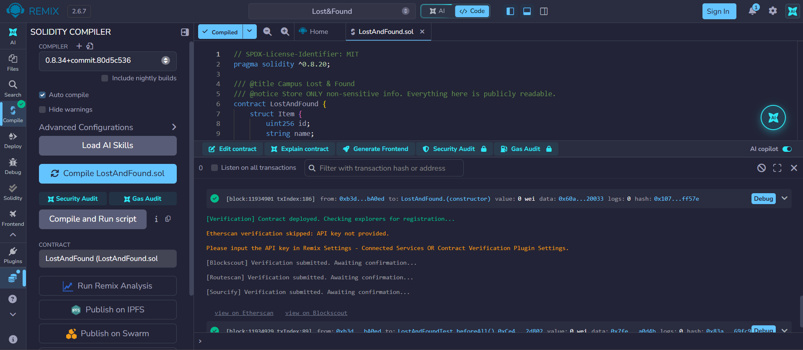
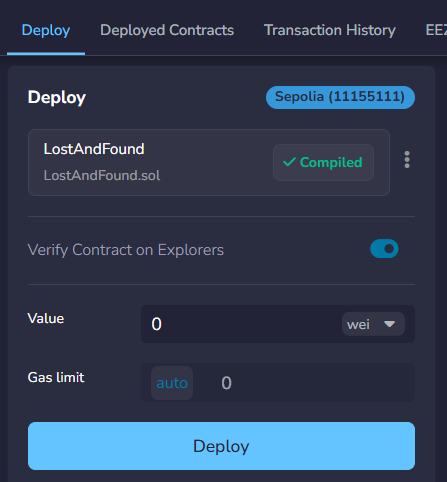
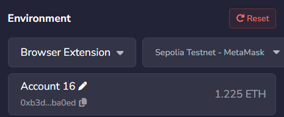
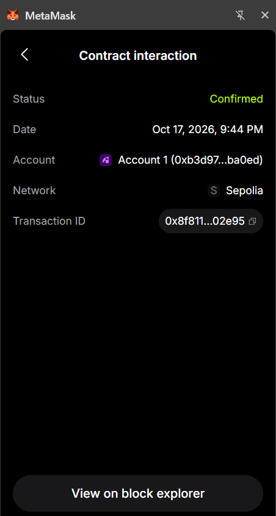
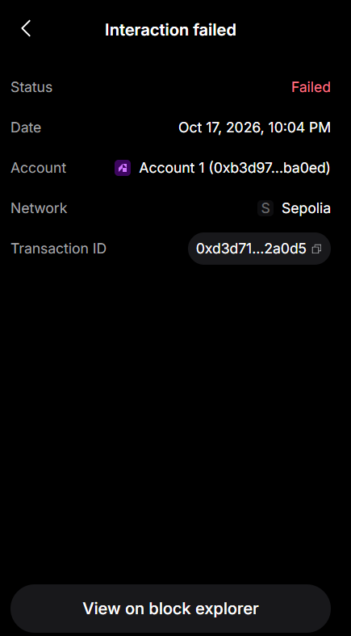
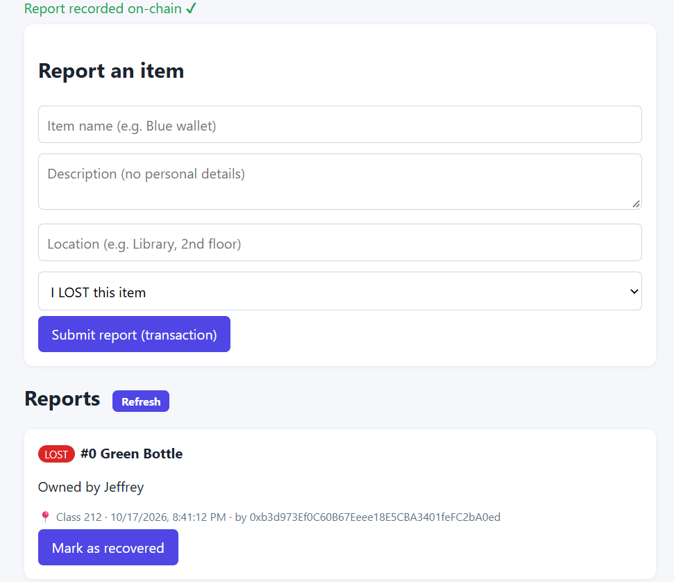

# Campus Lost & Found DApp

A blockchain-based application for reporting lost and found items on campus, built with Solidity, Ethers.js and MetaMask.

---

## 1. Problem Description

When people lose items on campus, such as ID cards, keys or wallets, it is hard to find the owner or to verify who reported an item. Notice boards and chat groups are unstructured, easy to edit or delete, and give no proof of who posted a report.

**Solution:** a decentralized application (DApp) where users can:

1. Connect their Ethereum wallet (MetaMask).
2. Report a lost or found item (name, description, location) as a blockchain transaction.
3. View all reports stored in the smart contract. Anyone can read them.
4. Mark an item as recovered. **Only the wallet that originally reported the item can do this.**

Because every report is stored on-chain with the reporter's wallet address and a timestamp, records are tamper-resistant and the reporter is verifiable.


### Technologies

| Tool | Purpose |
|------|---------|
| Solidity | Smart contract and access control |
| Remix IDE | Write, compile, test and deploy the contract |
| Ganache | Local Ethereum blockchain for testing |
| Sepolia | Ethereum public test network for deployment |
| HTML / CSS / JavaScript | Frontend |
| Ethers.js v6 + MetaMask | Wallet connection and transactions |
| Node.js + lite-server | Local web server for the frontend |

### Smart Contract Functions

| Function | Purpose |
|----------|---------|
| `constructor()` | Initializes the contract (stores the deployer address) |
| `reportItem(name, description, location, isFound)` | Adds a lost/found item; validates input and blocks duplicates |
| `getItem(id)` | Returns details of one item |
| `getAllItems()` | Returns all reported items |
| `markRecovered(id)` | Marks an item recovered; reporter only |

### Project Structure

```
campus-lost-found/
├── contracts/LostAndFound.sol
├── tests/LostAndFound_test.sol
└── frontend/
    ├── index.html
    ├── style.css
    ├── app.js
    ├── config.js        <- contract address goes here
    ├── package.json
    └── bs-config.json
```

---

## 2. Steps to Execute the Application

### Prerequisites

- Node.js (v18 or newer) and npm
- A desktop browser (Chrome, Brave, Edge or Firefox) with the **MetaMask** extension installed from metamask.io
- Free Sepolia test ETH from a Sepolia faucet (for the Sepolia deployment)

### Step 1: Deploy the smart contract (Remix)

1. Open https://remix.ethereum.org.
2. Create `contracts/LostAndFound.sol` and paste the contract code.
3. Go to the **Solidity Compiler** tab, select version 0.8.20 or newer, and click **Compile**.
4. (Optional) Create `tests/LostAndFound_test.sol`, open **Solidity Unit Testing**, and click **Run** to execute the unit tests.
5. In MetaMask, select the **Sepolia** network.
6. In Remix, open **Deploy & Run Transactions** and set **Environment** to **Browser Extension** (formerly "Injected Provider - MetaMask"). Approve the connection.
7. Confirm that the network shows **Sepolia (11155111)**, then click **Deploy** and confirm the transaction in MetaMask.
8. Under **Deployed Contracts**, click the copy icon to copy the contract address.

### Step 2: Configure the frontend

Open `frontend/config.js` and paste the address:

```js
export const CONTRACT_ADDRESS = "0x46aB62429Cc0963c874723b33e78bE81B19e13A1";
```

### Step 3: Run the frontend

```bash
cd frontend
npm install
npm run dev
```

The app opens at **http://localhost:3000**.


---

## 3. Connecting MetaMask and Interacting with the Contract

1. **Open the app** at http://localhost:3000. Existing reports are visible without a wallet (read-only).
2. **Connect:** click **Connect MetaMask**, then approve the popup. If asked, allow switching to the Sepolia network. The shortened wallet address appears at the top right.
3. **Report an item:**
   1. Enter the item name, description and location.
   2. Choose **I LOST this item** or **I FOUND this item**.
   3. Click **Submit report** and confirm the transaction in MetaMask.
   4. After confirmation, the item appears in the list with a LOST/FOUND badge.
4. **View reports:** all items are loaded from the smart contract via `getAllItems()`. Click **Refresh** to reload.
5. **Mark as recovered:** on an item you reported, click **Mark as recovered** and confirm in MetaMask. The item is shown faded with a **RECOVERED** badge. This button only appears for the original reporter, and the contract rejects anyone else.

---

## 4. Deployment Network and Contract Address

| Item | Value |
|------|-------|
| Network | Sepolia Testnet (Chain ID 11155111) |
| Contract name | `LostAndFound` |
| Contract address | `0x...............................` *(fill in after deployment)* |
| Deployer wallet | `0x...............................` *(fill in)* |
| Etherscan link | `https://sepolia.etherscan.io/address/<contract address>` |
| Compiler | Solidity ^0.8.20 |
| Local testing network | Ganache, Chain ID 1337, `http://127.0.0.1:7545` |

---

## 5. Test Cases and Results

Tests were run both as Remix unit tests (`tests/LostAndFound_test.sol`) and manually through the frontend using two wallets: **Account 1** (reporter) and **Account 2** (other user).

### 5.1 Contract unit tests (Remix)

| # | Category | Test function | Input | Expected result | Observed result | Status |
|---|----------|---------------|-------|-----------------|-----------------|--------|
| 1 | Valid | `testValidReport` | name "Blue Wallet", description "Blue leather wallet, no cards", location "Library" | Item stored with id 0, correct reporter, `recovered = false`, count = 1 | Item stored correctly; all assertions passed | Pass |
| 2 | Invalid | `testEmptyName` | name = `""` | Reverts with "Item name cannot be empty" | Transaction reverted with the expected message | Pass |
| 3 | Duplicate | `testDuplicate` | Same name, description, location and type reported twice by the same wallet | Second call reverts with "Duplicate report" | Second call reverted with the expected message | Pass |
| 4 | Unauthorized | `testUnauthorizedRecover` | A different address calls `markRecovered(0)` | Reverts with "Only the original reporter can do this" | Reverted with the expected message; item unchanged | Pass |
| 5 | Authorized | `testAuthorizedRecover` | Original reporter calls `markRecovered(0)` | `recovered` becomes `true` | `recovered` is `true` | Pass |

### 5.2 Frontend (manual) tests

| # | Category | Steps | Expected result | Observed result | Status |
|---|----------|-------|-----------------|-----------------|--------|
| 1 | View | Open the app without connecting a wallet | Page loads; list shows "No reports yet." or existing items; no errors | Page loaded and list displayed correctly | Pass |
| 2 | Valid | Connect Account 1; submit "Blue Wallet" + a valid description | MetaMask asks for confirmation; item appears with LOST badge and Account 1's address | Transaction confirmed; item displayed with correct details | Pass |
| 3 | Invalid | Leave the item name empty and click Submit | Error "Item name cannot be empty."; no transaction sent | Error shown; MetaMask did not open | Pass |
| 4 | Duplicate | Submit the exact same item again from Account 1 | Transaction fails with "Duplicate report"; no new item added | Failure message "Duplicate report" shown; list unchanged | Pass |
| 5 | Unauthorized (UI) | Switch to Account 2 and view Account 1's item | No "Mark as recovered" button is displayed | Button not shown for Account 2 | Pass |
| 6 | Unauthorized (contract) | Account 2 calls `markRecovered(0)` directly from Remix | Reverts with "Only the original reporter can do this" | Reverted with the expected message | Pass |
| 7 | Recover | Switch to Account 1 and click "Mark as recovered" | Transaction succeeds; item shows RECOVERED badge | Item shown as recovered | Pass |
| 8 | Persistence | Refresh the browser | All items and their status remain | Data persisted on-chain | Pass |


### 5.3 Screenshots 

▪ Smart contract compilation



▪ Smart contract deployment



▪ MetaMask wallet connection



▪ Successful transaction



▪ Failed transaction



▪ Blockchain data displayed through the user interface


    

- Screenshot: Remix unit test results (all passing)
- Screenshot: Etherscan page of the deployed contract
- Screenshot: the app showing a reported item and a recovered item
- Screenshot: failed transaction for the unauthorized case

---

## 6. Security and Design Notes

- **Access control:** `markRecovered` checks `msg.sender == reporter`. The frontend hides the button for others, but the contract is what enforces it.
- **Input validation:** the name and description must be non-empty, with maximum lengths (100 / 300 / 100 characters for name, description and location).
- **Duplicate prevention:** a hash of the reporter, name, description, location and type is stored. It applies per wallet so users cannot block each other's reports.
- **Privacy:** only non-sensitive information should be stored, because all on-chain data is public.
- **No keys in code:** private keys and seed phrases are never used in the project. MetaMask signs all transactions.
- **XSS safety:** the frontend renders user text with `textContent`, never `innerHTML`.

## 7. Limitations and Future Work

- Reports cannot be edited or deleted (blockchain data is immutable).
- A recovered item can only be re-reported by a new, different report.
- Possible additions: event-based search and filtering, pagination for large lists, and image hashes stored via IPFS.
